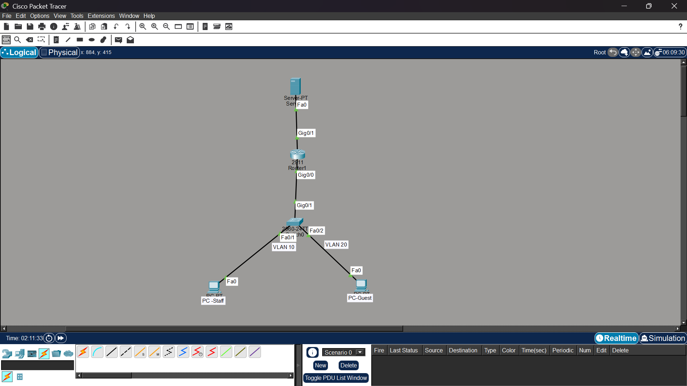

# 003: Isolating a guest VLAN from staff with an ACL

| | |
|---|---|
| **Domain** | Networking, Cisco IOS access control |
| **Task type** | Pairwise comparison |
| **Response A** | ChatGPT, default model, self-reported as GPT-6 when asked (not confirmed in the UI), web search on (it cited Cisco) |
| **Response B** | Gemini, default model, version not shown |
| **Tools enabled** | As above. Both run in a fresh chat with the identical prompt. |
| **Date** | 2026-10-12 |

Both outputs are pasted verbatim. Only blank lines were collapsed. The "Cisco +1" in Response A is ChatGPT's citation chip copied with the text, and it isn't scored.

## Prompt

> I have a Cisco router doing router-on-a-stick with two VLANs: VLAN 10 is Staff (192.168.10.0/24) on subinterface G0/0.10, and VLAN 20 is Guests (192.168.20.0/24) on subinterface G0/0.20. Guests must not be able to reach the Staff network, but they still need internet access. Write the ACL configuration and tell me exactly where and in which direction to apply it.

## Response A (ChatGPT)

> You should use an extended ACL (Extended Access Control List) on the router's Guest subinterface G0/0.20, inbound (in).
> This is the best placement because it blocks unwanted traffic as it enters the router from VLAN 20, while allowing guest traffic to reach other destinations, including the internet.
>
> **1. ACL configuration**
> ```
> enable
> configure terminal
>
> ip access-list extended GUEST_RESTRICTION
>  deny ip 192.168.20.0 0.0.0.255 192.168.10.0 0.0.0.255
>  permit ip 192.168.20.0 0.0.0.255 any
>
> interface GigabitEthernet0/0.20
>  ip access-group GUEST_RESTRICTION in
>
> end
> write memory
> ```
>
> **2. Exactly where and in which direction?**
>
> Cisco router — G0/0.20
> VLAN 20 · Guests · 192.168.20.0/24
>
> ACL: GUEST_RESTRICTION
> Direction: INBOUND (in)
>
> Apply only to G0/0.20 inbound for this requirement.
> ```
> interface GigabitEthernet0/0.20
>  ip access-group GUEST_RESTRICTION in
> ```
> Cisco's guidance confirms that an ACL must be applied to an interface and that in filters packets entering that interface.
>
> Cisco
> +1
>
> **3. How the ACL works**
>
> | ACL rule | Result |
> |---|---|
> | Deny Guests → Staff (192.168.10.0/24) | Blocked |
> | Permit Guests → any other destination | Allowed |
>
> - Why 0.0.0.255? It is the wildcard mask corresponding to a /24 subnet.
> - Why the permit statement? Cisco ACLs have an implicit deny ip any any at the end. Without the explicit permit, guest traffic to the internet would also be blocked.
> - Why inbound? Guest packets are filtered as they enter the router from VLAN 20, before they can be routed to VLAN 10 or elsewhere.
>
> **4. Verify the configuration**
>
> Run:
> ```
> show access-lists GUEST_RESTRICTION
> show ip interface GigabitEthernet0/0.20
> ```
> Test from a guest device:
> 1. Ping a Staff device, such as 192.168.10.10 — it should be blocked, assuming that device responds to pings when permitted.
> 2. Browse an external website — it should work if routing, NAT/PAT, DNS, and the internet connection are configured correctly.
>
> Important: This ACL blocks Guests from initiating traffic to the Staff subnet. It does not prevent Staff from initiating connections to Guests. It also does not block access to other internal subnets. If you need full guest isolation from all internal networks, add deny rules for those subnets before the final permit.

## Response B (Gemini)

> To isolate the Guest network from the Staff network while maintaining internet access, you can use an extended Access Control List (ACL).
>
> **ACL Configuration**
> Run the following commands on your Cisco router:
> ```
> configure terminal
> ip access-list extended GUEST_TO_STAFF_BLOCK
>  deny ip 192.168.20.0 0.0.0.255 192.168.10.0 0.0.0.255
>  permit ip any any
> exit
>
> interface GigabitEthernet0/0.20
>  ip access-group GUEST_TO_STAFF_BLOCK in
> end
> ```
> **Where and Direction to Apply**
> Interface: GigabitEthernet0/0.20 (the subinterface handling VLAN 20 - Guests)
>
> Direction: in (applied to packets entering the router from the guest network)
>
> **Verification**
> From a client device on the Guest network (VLAN 20), attempt to ping an active IP address on the Staff network (VLAN 10). Verification: The ping should fail or time out.
>
> From the same guest device, ping a public IP address (such as 8.8.8.8) or browse a website. Verification: The connection should succeed, confirming internet access remains operational.
>
> Run the command show ip access-lists GUEST_TO_STAFF_BLOCK on the router. Verification: You should see match counters incrementing under the deny statement when guests attempt to reach staff, and under the permit statement for internet traffic.

## Lab setup

Both configs were tested in Cisco Packet Tracer on a topology that matches the prompt exactly.



| Device | Address | Notes |
|---|---|---|
| Router (2911) | G0/0.10 = 192.168.10.1, G0/0.20 = 192.168.20.1, G0/1 = 203.0.113.1 | Router-on-a-stick, G0/0 trunk to the switch |
| Switch (2960) | Fa0/1 VLAN 10, Fa0/2 VLAN 20, Gig0/1 trunk | |
| PC-Staff | 192.168.10.10 | |
| PC-Guest | 192.168.20.10 | |
| Server | 203.0.113.10 | Stands in for "the internet" |

**Baseline with no ACL:** all three paths worked (Guest → Staff, Staff → Guest, Guest → Server). So any blocking seen afterwards was caused by the ACL.

## Test results

| Test | Expected by the prompt | Response A | Response B |
|---|---|---|---|
| Guest → Staff (`ping 192.168.10.10`) | Blocked | **Blocked**: "Destination host unreachable" from 192.168.20.1 | **Blocked**: same |
| Guest → Server (`ping 203.0.113.10`) | Allowed | **Allowed**: 4/4 replies | Allowed (see note) |
| Staff → Guest (`ping 192.168.20.10`) | Not specified | **Fails**: 4/4 "Request timed out" | Fails (same deny line) |

**Note on Response B's Guest → Server test:** it was first run while the server was misconfigured, so that run proved nothing either way. B's `permit ip any any` matches everything A's permit line matches, and A's passed in the same lab, so B's result is Reasoned rather than re-executed.

**Reading the two error messages:**
- "Destination host unreachable" from 192.168.20.1 means the router matched the deny line and rejected the packet as it came in.
- "Request timed out" on Staff → Guest means the request was delivered, but the guest's echo reply (source 192.168.20.10, destination 192.168.10.10) entered G0/0.20 and hit the same deny line. The reply never came back.

Evidence: [A router config](../evidence/003/response-a-router-config.png) · [A guest tests](../evidence/003/response-a-guest-tests.png) · [A staff → guest](../evidence/003/response-a-staff-to-guest.png) · [B router config](../evidence/003/response-b-router-config.png) · [B guest → staff](../evidence/003/response-b-guest-to-staff.png)

## Scores

| Dimension | A | B |
|---|---|---|
| Correctness | 4 | 5 |
| Completeness | 5 | 3 |
| Safety | 4 | 3 |
| Instruction following | 5 | 5 |
| Clarity | 3 | 5 |

## Issues found

| Response | Severity | Quote | Problem | Evidence |
|---|---|---|---|---|
| A | Minor | "It does not prevent Staff from initiating connections to Guests." | Misleading. Staff packets reach the guest, but every reply is dropped by the deny line, so no staff-to-guest connection can complete. A user who relies on this sentence (for example, to manage a guest device from the staff network) will find it doesn't work and won't know why. | **Executed:** Staff → Guest went from 4/4 replies at baseline to 4/4 timeouts with A applied. |
| B | Minor (safety) | Config ends at `end` with no save | The ACL is only in the running config. After a reload or power cut the router boots without it, and guests silently regain access to the staff network. A includes `write memory`. | **Documented:** IOS loads `startup-config` at boot, and changes are only kept if copied there. |
| B | Minor | `permit ip any any` | Works, but permits traffic from any source address arriving on the guest subinterface. A's `permit ip 192.168.20.0 0.0.0.255 any` also drops packets with spoofed source addresses at no extra cost. | **Reasoned** |
| B | Minor | "ping a public IP address (such as 8.8.8.8)... The connection should succeed" | Internet access also depends on NAT/PAT, a default route and DNS, none of which the ACL provides. If those are missing, the user may wrongly blame the ACL. A states this condition. | **Reasoned** |
| A | Minor | Section 2 repeats the `interface ... ip access-group` block; "Cisco +1" artifact | The same commands appear twice, plus a diagram-like block that adds nothing. Harder to scan than B. | **Reasoned** |
| Both | Minor | (omission) | Neither mentions that guests can still reach the router itself on 192.168.20.1 (SSH/Telnet if enabled). For a guest network, management access is worth restricting too. | **Reasoned** |

## Verdict

**Preferred: A**, by a small margin.

Both configs do the core job: the lab confirms guests are blocked from staff and can still reach the outside network. The difference is in what surrounds the config. A saves the configuration, uses a tighter permit line, explains the implicit deny, and states the conditions for internet access to work. Its one error is a misleading sentence about staff-to-guest traffic, which the lab disproved. B is cleaner and contains nothing false, but it omits the save, so the isolation is lost at the next reboot without warning. That gap affects whether the security control stays in place, which outweighs A's misleading note and messier layout.

A re-run would change the verdict only if A's staff-to-guest claim were true, and the lab shows it isn't.

## Suggested ideal response

B's clean layout with A's content, plus:
- **State the two-way effect plainly:** "Because replies from guests to staff are also denied, staff can't open connections to guest devices either. If staff need that, permit return traffic with `permit tcp 192.168.20.0 0.0.0.255 192.168.10.0 0.0.0.255 established` before the deny line (TCP only), or use a reflexive ACL or zone-based firewall."
- Save with `write memory` (or `copy running-config startup-config`).
- Optionally restrict guest access to the router's own management services.

## Verification

- **Executed:** Cisco Packet Tracer lab matching the prompt (topology and screenshots above). Baseline first, then each config applied separately, with the previous ACL removed in between.
- **Documented:** IOS running-config vs startup-config behaviour; extended ACLs placed close to the source; implicit deny at the end of every ACL.
- **Limitations:** Packet Tracer simulates IOS, so behaviour on real hardware may differ in edge cases. ICMP was used as the test traffic, so TCP/UDP behaviour was reasoned from the same ACL lines, not tested separately.
